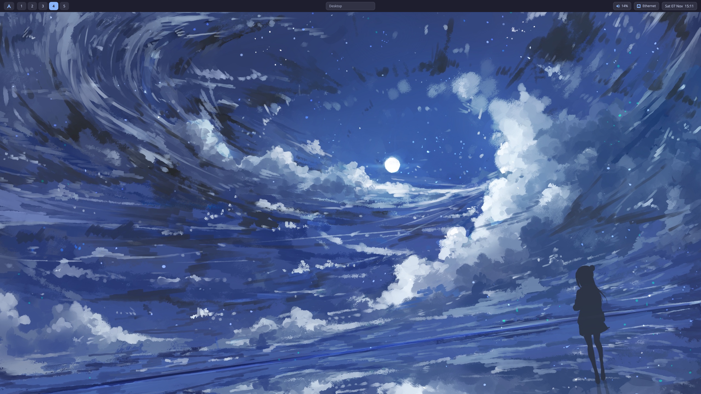
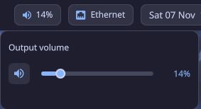
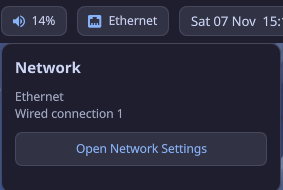
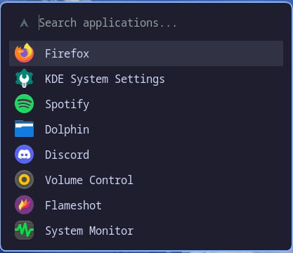

# ☾ Moonforge

**An Arch Linux desktop, forged after dark.**

Moonforge is an Arch Linux dotfiles project built incrementally around Hyprland, Quickshell, and a carefully tuned keyboard-driven workflow.

The goal is a cohesive, lightweight desktop that feels personal without becoming difficult to understand, maintain, or reproduce.

## ✦ The stack

| Component | Purpose |
|---|---|
| Arch Linux | Operating system |
| Hyprland | Wayland compositor |
| Quickshell | Custom desktop shell and status bar |
| Fuzzel | Application launcher |
| Kitty | Terminal emulator |
| awww | Wallpaper management |
| Dolphin | File manager |

## ◈ Design language

Moonforge uses a moonlit, Catppuccin Mocha-inspired palette, with soft blue and lavender accents, rounded surfaces, and restrained visual effects.

| Color | Hex |
|---|---|
| Background | `#1e1e2e` |
| Surface | `#313244` |
| Hover | `#45475a` |
| Blue accent | `#89b4fa` |
| Lavender accent | `#cba6f7` |
| Main text | `#cdd6f4` |

## 🖥️ Screenshots

### Desktop



### Components

| Audio controls | Network controls |
|---|---|
|  |  |

| System tray menu | Fuzzel launcher |
|---|---|
|  |  |

## ✨ Current features

- **Hyprland** — window layout settings and keyboard bindings.
- **Quickshell bar** — launcher, workspace buttons, active-window title, system tray, and clock.
- **Audio controls** — volume indicator, wheel-based volume adjustment, and a custom volume popup.
- **Network controls** — connection status, Wi-Fi scanning, connecting to secured and open networks, saved-network recognition, and Ethernet status.
- **Settings popup and power menu** — quick access to desktop controls and power actions.
- **Custom tray menus** — themed popup menus positioned relative to their tray icons.
- **Fuzzel** — themed application launcher, bound to `Super + Space`.
- **Kitty** — Moonforge terminal color theme.
- **awww** — wallpaper setup using the Moonforge wallpaper.

This project is being built and tested on a personal Arch Linux installation. Some details may be specific to that setup, and the configuration is still evolving.

## 📁 Repository layout

```text
.
├── hypr/        # Hyprland configuration
├── quickshell/  # Custom shell, bar, and popups
├── fuzzel/      # Application launcher theme
├── kitty/       # Terminal color theme
├── wallpapers/  # Moonforge wallpaper
└── screenshots/ # Desktop and component screenshots
```

## 🛠️ Applying configurations

**Back up your existing configuration files before replacing them.**

The files in this repository are maintained separately from their active copies under `~/.config/`. Review each file and copy or link it into place only when you're ready. These configurations are tailored to the current setup and may need adjustments on another machine.

The wallpaper is stored in `wallpapers/moonforge_wallpaper.jpg`.

See [INSTALL.md](INSTALL.md) for installation instructions, including the installer options and a manual setup path. Review the configuration before applying it to another machine.

## 🗺️ Roadmap

### Desktop shell

- [x] Build and polish the Quickshell bar with launcher, workspace indicators, window title, audio/network controls, system tray, and clock.
- [x] Add workspace switching with animated active-workspace indicators.
- [x] Add the grouped notification center with app grouping, expand/collapse, individual and group dismissal, clear-all, and unread count.
- [x] Add the date/time popup with a navigable monthly calendar.
- [x] Add the Settings popup and power menu.
- [ ] Expand Settings with Appearance, Desktop, Notifications, Audio, System, and Display sections.
- [ ] Add per-application volume controls.
- [ ] Improve responsive behavior and layout across different screen sizes.

### Theme and desktop integration

- [ ] Improve theme consistency across Fuzzel, Kitty, notifications, icons, lock screen, and other desktop components.
- [ ] Finish the matching Hyprlock theme integration.
- [ ] Make wallpaper setup and startup more reliable.
- [ ] Explore further desktop polish and optional quality-of-life widgets.

### Reliability and documentation

- [x] Remove machine-specific monitor, network-interface, home-directory, and wallpaper-path assumptions where practical.
- [x] Add screenshots to the README.
- [x] Add an installation script with package checks, protected Hyprland configuration, and backup reporting.
- [x] Add dry-run and package-skip options for safer installation.
- [ ] Add backup and restore support.
- [ ] Document keybindings, customization points, and troubleshooting steps.

The roadmap is a living list; items may change as the desktop develops.

## 🛡️ Philosophy

- Preserve a working desktop while experimenting.
- Prefer native packages and lightweight tools.
- Keep configurations readable and version-controlled.
- Make changes incrementally and test them before moving on.
- Never commit credentials, private keys, or personal data.
- Avoid interfering with other desktop environments, including KDE Plasma.

## 🚧 Project status

**Work in progress.** The installer and current configuration are available for testing, but hardware-specific behavior and future changes may still require manual adjustments. See [CHANGELOG.md](CHANGELOG.md) for version history.

---

*Forged in the dark. Built one commit at a time.*
